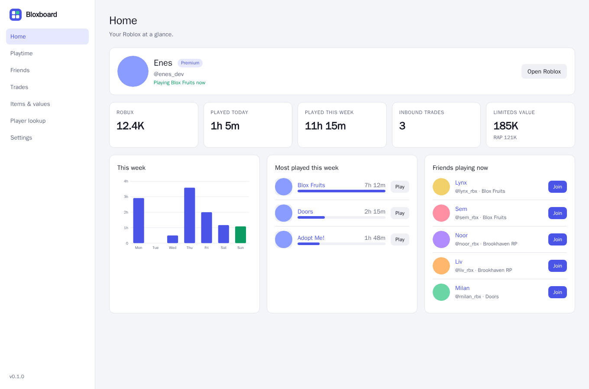

# Bloxboard

**A free Roblox companion for your browser.** Server regions, a player finder, playtime stats, trade values and a full dashboard. No subscriptions, no paid tiers, no account to make.

Works in Chrome, Edge, Brave, Helium and other Chromium browsers.

**[Download from bloxboard.enesserver.dev](https://bloxboard.enesserver.dev)** · [Changelog](CHANGELOG.md) · [Roadmap](docs/PLAN.md)

## Why Bloxboard?
**Ever get tired of the features you need sitting behind a paywall?**
Well, we don't do that! All of our features are free to use!
We know the struggles of trying to find a free copy, all for a few minor quality of life additions.

## Is it safe?
**Yes!**
It is safe, and if you don't believe us, check the source code. It is fully open sourced. See [Privacy](#privacy) for exactly what it talks to.

Q: Why isn't it on the Chrome Web Store?
A: We haven't got around to that yet, but just you wait!

## What it does

On roblox.com it adds one panel to game pages and a thin bar to profiles. Everything else lives in its own dashboard tab (click the Bloxboard icon in your toolbar).

**On game pages**
- **Server browser** with regions. Filter by region, players, free slots, ping, FPS and friends. Join the best server, a random one, or copy an invite link.
- **Player finder.** Friends are found instantly; anyone else is found by scanning servers for their avatar. Search by username or display name.
- **Recent servers** you played in, with a Rejoin button.
- **Live stats** and your **badge progress**, missing badges first and the easiest on top.

**Across roblox.com**
- **Quick search** under Roblox's search box: games with a Play button, limiteds with values, players.
- **Trade calculator** in the trade window, with a warning before you send or accept a lowball.
- **Item values** (value, RAP, demand, trend) on every limited, and **profile info** (inventory value, mutual friends, last online).
- Your **playtime** on game cards and a **Most played** row on the home page.
- Optional **themes** for roblox.com.

**In the dashboard**
- **Playtime** per day and per game, streaks and a heatmap (up to 90 days).
- **Trades** with values, win or loss, and profit over time.
- **Friends** online and what they're playing, plus a log of who added or removed you.
- **Robux** in and out, per month and per game.
- **Avatar sandbox**: try any item on your avatar without buying it, and save outfits.
- **Notifications** for new trades and updates to your favorite games.

## Install

Bloxboard isn't on the Chrome Web Store, so it's installed from the website. The full steps with pictures are at [bloxboard.enesserver.dev](https://bloxboard.enesserver.dev). The short version:

1. Download the **.zip** from the website and unzip it somewhere it can stay (for example `Documents\Bloxboard`).
2. Open your browser's extensions page (`chrome://extensions`, `edge://extensions`, `brave://extensions`) and turn on **Developer mode**.
3. Click **Load unpacked** and pick the `bloxboard` folder (the one with `manifest.json` inside).
4. Log in on roblox.com and click the Bloxboard icon to open the dashboard.

To update, unzip the new version over the same folder and click the reload icon on the Bloxboard card. Your settings and playtime stay.

In Helium you can install the `.crx` directly instead, and it then updates itself. See the website for how.

## Companion (Windows)

A small always-on-top window next to Roblox with your server's location, time in server, Copy invite, Server hop and Rejoin. It starts and closes with Roblox through Fishstrap or Bloxstrap.

It only reads the log file Roblox writes to `%LOCALAPPDATA%\Roblox\logs`, the same way Fishstrap and Bloxstrap do. It doesn't inject anything into the game, read its memory, or touch your account. Download and setup: [bloxboard.enesserver.dev/companion.html](https://bloxboard.enesserver.dev/companion.html).

## Community

Share Roblox Studio scripts, outfits and posts at [bloxboard.enesserver.dev/community](https://bloxboard.enesserver.dev/community). Anyone can read; to post, apply and an admin approves you.

## Privacy

- Bloxboard talks to Roblox as you, using your normal roblox.com login. It never sends your cookie or login anywhere else.
- Your playtime, notes, outfits and settings are stored in your browser. Nothing goes to the Bloxboard site unless you choose to share something to the Community, which uses Roblox's official sign-in.
- Item values come from [Rolimons](https://www.rolimons.com). Server regions are looked up from the server's IP address with [ipwho.is](https://ipwho.is).
- Auto-decline for bad trades is off by default, and Bloxboard never accepts or sends a trade on its own.

## Contributing

Bug reports and ideas are welcome: [open an issue](https://github.com/coolacccccccccccccc/bloxboard/issues). If something breaks, **Settings → Diagnostics** in the dashboard checks every Roblox service Bloxboard uses and lets you copy the result into your report.

To work on the extension:

1. Clone this repo.
2. Open your browser's extensions page, turn on **Developer mode**, click **Load unpacked** and pick the `extension/` folder.
3. After editing, click the reload icon on the Bloxboard card and refresh roblox.com.

There's no build step for the extension: it's plain JavaScript (Manifest V3).

| Path | What |
|---|---|
| `extension/` | The browser extension. |
| `extension/lib.js` | Shared helpers: Roblox API calls, Rolimons values, formatting, a small DOM builder. |
| `extension/background.js` | Service worker: playtime tracking, notifications, server-region lookups. |
| `extension/content/` | Scripts that run on roblox.com pages (game, profile, home, search, trade, item, cards, themes). |
| `extension/dashboard/` | The dashboard tab. |
| `companion/` | The Windows companion app (C#, .NET 8). |
| `hub/api/` | The community backend (Python). |
| `site/` | The website. |
| `tools/` | Build and release scripts. |

Release and hosting notes for the maintainer are in [docs/MAINTAINING.md](docs/MAINTAINING.md).

---

Bloxboard is a fan project and isn't affiliated with or endorsed by Roblox Corporation.
